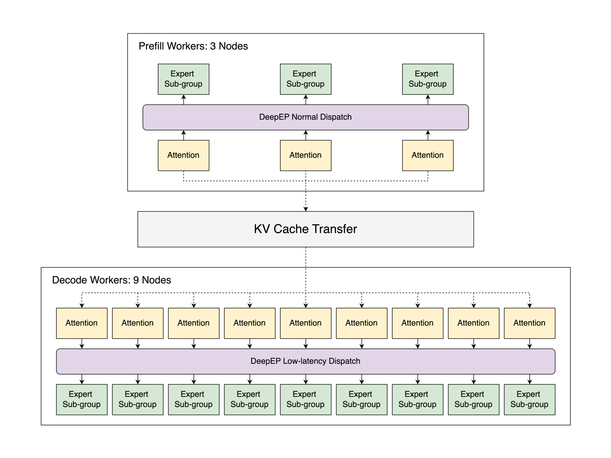
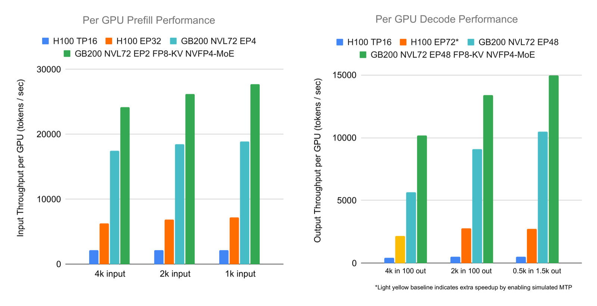

# SGLang：与具体硬件的对应

> 引擎 × 硬件 · SGLang 固定提交文档、LMSYS 官方部署与数据手册推算

SGLang 的软件机制（RadixAttention、HiCache 三级缓存、P/D 分离）已在本组第 1 章说明，HDD 接入点见第 2 章。本章把这些组件落到具体硬件上：官方文档在固定提交下支持哪些加速器，L1/L2/L3 与 P/D 传输各对应哪种设备和链路，启动参数换算成多少 GB 和多少 token，以及按两款代表模型算出的取回时间下界。文档与源码固定在提交 `c712459e7f82`（2026-11-16，晚于发布版 v0.5.23），硬件数值取自厂商产品页与数据手册，均采集于 2026-11-20。 [SGI16][SGH1]

### 官方硬件支持矩阵（固定提交）

文档的 Hardware Platforms 目录列出 NVIDIA GPU、AMD GPU、昇腾 NPU、CPU 服务器、Jetson Orin、TPU、Intel XPU 和摩尔线程 GPU；同一目录还有寒武纪 MLU、平头哥 SAIL、Apple Metal 等页面。启动参数 `--device` 可取 `cuda / xpu / hpu / npu / cpu`。下表的“成熟度”根据文档对安装方式和覆盖范围的描述归纳，SGLang 并没有给各平台评定官方 / 社区 / 实验等级。 [SGH3][SGH9][SGH25]

| 平台 | 文档列出的型号 | 软件栈与版本要求 | KV 相关后端 | 成熟度（据文档归纳） |
|---|---|---|---|---|
| NVIDIA CUDA | 安装页未给型号清单。内存默认值代码按显存分档，注释写 H100/A100（<90 GB）、H20/H200（<160 GB）、B200/MI300（≥160 GB）；FlashInfer 默认注意力后端要求 sm75 及以上 | CUDA 13 兼容驱动；镜像和 wheel 只提供 CUDA 13，v0.5.19 是最后一个 CUDA 12 版本。torch 2.14.1、flashinfer-python[cu13] 0.7.4、nvshmem4py-cu13；AWS 平台另有 `-efa` 镜像 | P/D：mooncake（默认）、nixl、mooncake_tcp；HiCache L3：file、fast_file、mooncake、hf3fs、nixl、aibrix 等 | 主平台，有预构建镜像和 wheel |
| AMD ROCm | 文档以 MI300X 为例，并提到 MI250；Dockerfile 的构建目标为 gfx942（镜像标签 mi30x）、gfx950（mi35x）、gfx1250（mi45x）；另有 Strix Halo gfx1151 专用镜像 | ROCm 7.0 / 7.2 / 7.2.4 / 10.0 / 10.1 构建变体；AITER 加速；MoRI 网卡支持 ainic / bnxt，并可自动探测 | P/D：mori、nixl（UCX，带 ROCm 支持） | 官方 Dockerfile 和镜像；量化方法有一部分不可用 |
| 华为昇腾 | A3 系列；950PR/DT 系列 | HDK 25.5.2、CANN 9.1.0、TorchNPU 2.10.0.post6、MemFabric 1.2.1、memcache 1.2.1，文档要求各版本严格成套使用 | P/D：ascend（memfabric_hybrid）；HiCache：`kernel_ascend` I/O、`npu_memcache` 存储 | 有独立文档树，包含多模型最佳实践 |
| Google TPU | SGLang-TorchTPU：TPU7x（Ironwood），单机 4 芯片 / 8 TensorCore；SGL-JAX：TPU v6e（文档写 32 GB HBM）、v7（文档写每核 96 GB） | 独立仓库与运行时 | TorchTPU 支持前缀缓存、主机内存 KV 卸载和 P/D 分离，具体组合取决于模型和拓扑 | 独立后端 |
| Intel GPU / CPU | XPU：Arc Pro B 系列、Arc B 系列；CPU：第 4 代及以上带 AMX 的 Xeon Scalable | XPU 只能从源码安装；CPU 使用 `-xeon` 镜像 | XPU 上的 Mooncake / NIXL 需要用 XPU 镜像，或从源码构建 | XPU 源码级；CPU 有镜像 |
| Intel Gaudi、AWS Trainium | `--device` 有 `hpu` 选项，但 Hardware Platforms 目录没有 Gaudi 页面；Trainium 未出现 | — | — | 文档未提供平台指南 |

对 KV 存储来说，平台差异主要体现在两条数据面上。P/D 传输由各平台自己的传输库承担：NVIDIA 走 Mooncake 或 NIXL，AMD 走 MoRI，昇腾走 MemFabric。HiCache 的主机–设备搬运同样分平台实现，CUDA 上是 `kernel` 或 `direct`，昇腾上是 `kernel_ascend`。因此在 NVIDIA 上验证过的 HDD 冷层方案，迁到其他平台后需要重新测量。 [SGH9][SGI32][SGH2][SGH4][SGH5][SGH6][SGH7][SGH8]

### KV 层级与数据通路 → 具体硬件

| 层级 / 通路 | 引擎中的组件或参数 | 典型硬件（型号） | 容量 | 带宽 / 延迟 | 来源 |
|---|---|---|---|---|---|
| L1 设备 KV 池 | `MLATokenToKVPool` / `MHATokenToKVPool`；`--mem-fraction-static`、`--page-size`、`--kv-cache-dtype` | H200 SXM；B200（DGX B200）；GB200 超级芯片 | H200 141 GB；B200 每卡 180 GB（1,440 GB ÷ 8）；GB200 每超级芯片 372 GB | H200 4.8 TB/s；B200 每卡 8 TB/s（64 TB/s ÷ 8）；GB200 每超级芯片 16 TB/s | [SGI2][SGH23][DSH3][DSH4] |
| L2 主机池 | `HostKVCache`；`--hicache-ratio`（cache 模式默认 2.0）、`--hicache-size`（GB）、`hicache_host_memory_fraction`（默认 0.8） | DGX B200 双路 Xeon 8570；GB200 Grace LPDDR5X | DGX B200 2 TB（可配至 4 TB）；GB200 每超级芯片最高 480 GB | GB200 LPDDR5X 每超级芯片最高 512 GB/s | [SGI9][DSH3][DSH4] |
| L2 ↔ L1 回填 / 写回 | `--hicache-io-backend kernel\|direct`；`--hicache-mem-layout page_first` 等 | PCIe Gen5 x16（HGX / DGX）；NVLink-C2C（Grace 平台） | — | PCIe Gen5 128 GB/s 双向，即每方向约 64 GB/s；NVLink-C2C 900 GB/s 双向 | [SGH14][DSH5][SGH22] |
| L3 本地 NVMe | `file` / `fast_file`；文档示例 `/mnt/nvme/hicache`，`max_size 3Ti`、`read_workers 8` | DGX B200 内置 8 × 3.84 TB NVMe U.2（型号未公开）；代表盘 Solidigm D7-PS1010 | 30.72 TB / 节点 | PS1010 128 KB 顺序读最高 14,500 MB/s、写 10,500 MB/s，4 KB 随机读最高 330 万 IOPS | [SGH14][DSH3][SGH24] |
| L3 远端池 / 文件系统 | `mooncake`（RDMA、多网卡、GPUDirect 零拷贝）；`hf3fs` | ConnectX-7（DGX B200 有 8 个单口）；BlueField-3 | Mooncake 由 `global_segment_size` 决定，官方示例为 816,043,786,240 B（约 816 GB）/ 节点 | 每口最高 400 Gb/s（线速 50 GB/s） | [SGH16][SGI21][DSH3] |
| P/D KV 传输 | `--disaggregation-transfer-backend`、`--disaggregation-ib-device`（支持按 GPU 映射 JSON） | ConnectX-7 / IB；AWS EFA；GB200 NVL72 机内 NVLink | — | NVLink 5 每 GPU 1,800 GB/s；NVL72 域内 130 TB/s | [SGI32][DSH6][SGH21] |
| HDD 冷层（官方未使用，作对照） | `file` / `fast_file` 指向 HDD 挂载点（见第 2 章） | Seagate Exos 30 TB（ST30000NM004K）；Exos E 4U106 机箱 | 每盘 30 TB；每机箱 106 盘位 | 每盘持续 275 MB/s；4K QD16 随机读 / 写 170 / 350 IOPS；平均延迟 4.16 ms；4U106 机箱最大 36 GB/s | [BH11][KT11] |

**参数换算成硬件量。**未指定 `--mem-fraction-static` 时，源码先估出激活和 CUDA Graph 预留量 reserved_mem（MB），再按 (显存 − reserved_mem) ÷ 显存 计算比例。reserved_mem 的组成是 512 + 1.5 × chunked_prefill_size + TP×PP/8×1024 再加上 Graph 预留；显存大于 60 GB 的卡至少预留 10 GB。chunked_prefill_size 也按显存分档：H100 / H200 档取 8192，≥160 GB 的 B200 档取 16384。由于 MLA 在各 TP rank 上复制同一份 KV，TP8 下 8 卡各自持有完整的 latent KV，整机 token 容量等于单卡容量。GQA 模型则按 KV head 切分，整机容量按各卡之和计算。L2 主机池可用 `--hicache-ratio` 设为设备池的倍数，也可用 `--hicache-size` 直接给出 GB 数（按 1e9 字节 ÷ 每 token 字节数换算成 token 数）。两项都未设置时，自动定容把每台机器的主机池限制在可用内存扣除 10 GiB 后的 80% 以内，并在各 rank 之间取最小比例。L3 命中的数据要先在主机池落地，再回填到 GPU，因此主机池必须大于设备池，否则存储命中会被丢弃并改为重算。 [SGH10][SGH9][SGI35][SGH13][SGH14]

### 量化算例：DeepSeek-V3（MLA）与 Llama-3.1-70B（GQA）

**每 token KV 字节。**DeepSeek-V3 官方推理配置给出 n_layers = 61、kv_lora_rank = 512、qk_rope_head_dim = 64。SGLang 的 MLA 池每层每 token 存 512 + 64 = 576 个元素，BF16 下为 576 × 61 × 2 = **70,272 B**（约 68.6 KiB），FP8 KV 下为 35,136 B。Llama-3.1-70B 的参数是 dim 8192、n_heads 64、n_kv_heads 8、n_layers 80，head_dim = 8192 ÷ 64 = 128。BF16 下每 token 为 2 × 80 × 8 × 128 × 2 = **327,680 B**（320 KiB）；TP8 时每卡只存 1 个 KV head，即 40,960 B。 [SGH18][SGI2][SGH19]

**单卡能放多少 token（本文分析）。**假设条件：取官方示例常用的 `--mem-fraction-static 0.85`；DeepSeek-V3 FP8 权重按 671 GB 计，Llama BF16 权重按 140 GB 计，TP8 时均匀分到 8 卡；忽略页对齐与元数据。在 H200 上，静态区约 119.9 GB，DeepSeek 扣除权重 83.9 GB 后剩约 36.0 GB，可放约 **51 万 token**（BF16 KV）或 102 万 token（FP8 KV），因为 MLA 复制，整机容量也是这个数。Llama TP8 每卡剩约 102.4 GB，整机约 **250 万 token**。B200 按每卡 180 GB 计，DeepSeek 约 98 万 / 197 万 token，Llama 约 331 万 token。主机侧再看 DGX B200：DeepSeek 按 ratio 2 需要约 8 × 138 GB ≈ 1.1 TB 主机池，2 TB 内存装得下；Llama 需要约 8 × 271 GB ≈ 2.17 TB，超过 (2 TB − 10 GiB) × 0.8 ≈ 1.59 TB 的预算，自动定容会把比例从 2 降到约 1.39。

**32k 前缀的大小与取回下界。**32,768 token 的 DeepSeek 前缀在 BF16 下为 2.30 GB（FP8 为 1.15 GB），而且每个 TP rank 都要有一份。Llama 前缀共 10.74 GB，TP8 时每卡 1.34 GB。下表只计入传输时间，带宽取各链路的标称单方向峰值，并假设每卡独占一条 PCIe 链路和一张网卡、没有其他流量竞争；HDD 行按顺序读计算，不含定位时间。

| 取回路径（标称带宽） | DeepSeek-V3 每卡 2.30 GB | Llama-70B 每卡 1.34 GB（整机 10.74 GB） |
|---|---|---|
| L1 HBM 读：H200 4.8 TB/s / B200 8 TB/s | 0.48 / 0.29 ms | 0.28 / 0.17 ms |
| L2 → L1：PCIe Gen5 每方向 64 GB/s | 36 ms | 21 ms |
| L2 → L1：NVLink-C2C 900 GB/s 双向，按每方向 450 GB/s 计 | 5.1 ms | 3.0 ms |
| 远端 RDMA：每卡 1 × 400 Gb/s（50 GB/s） | 46 ms | 27 ms |
| 本地 NVMe：1 块 PS1010（14.5 GB/s）/ 8 块并行（116 GB/s，单副本） | 159 / 20 ms | 整机 741 / 93 ms |
| HDD：10 块 Exos 30 TB 顺序读（2.75 GB/s）/ 一台 4U106（36 GB/s） | 837 / 64 ms（单副本） | 整机 3.9 s / 298 ms |
| 对照：重算 prefill | H100 节点 4K 输入为 50,302 tok/s/节点，折合约 0.65 s；GB200 FP8-KV + NVFP4 下 2 rank 实例 2K 输入为 26,156 tok/s/GPU，折合约 0.63 s | 待实测（官方未给出 Llama-70B 在 H200 / B200 上的 prefill 吞吐） |

重算时间由 2K / 4K 输入下的吞吐折算而来。32k 输入的注意力开销更大，实际重算会更慢，所以表中数值是重算时间的下界。即便如此，PCIe、C2C、RDMA 和多盘 NVMe 的取回时间都比重算低一个数量级。10 块盘的 HDD 阵列在只算传输、不算定位的情况下，已经与重算处于同一量级。 [SGH20][SGH22][SGH23][DSH5][SGH24][BH11][KT11]

### 官方 / 公开参考部署

| 部署（来源） | 机型与卡数 | 网络 / KV 传输 | 公开结果 |
|---|---|---|---|
| LMSYS 大规模 EP + P/D（2025-05-05） | Atlas Cloud 12 节点 × 8 H100（共 96 卡）；架构图为 Prefill 3 节点、Decode 9 节点 | InfiniBand；KV 传输经 RDMA，可用 Mooncake / NIXL；每节点网卡数量未写明 | 每节点 52.3k 输入 / 22.3k 输出 tok/s（2K 输入）；prefill 4 节点 EP32 下 1K / 2K / 4K 输入分别为 57,674 / 54,543 / 50,302 tok/s/节点；decode 9 节点 EP72 为 22,282 tok/s/节点 |
| GB200 NVL72 Part I（2025-06-16） | NVL72 内 14 个节点：12 个做 decode，其余做 prefill | 纯 NVLink 域；Blackwell 版 Mooncake 支持经 NVLink 传 KV | decode 7,583 tok/s/GPU（2K 输入），是 H100 的 2.7 倍 |
| GB200 NVL72 Part II（2025-09-25） | decode 48 rank；prefill 每实例 4 rank（高精度）或 2 rank（低精度） | 利用 CPU–GPU 900 GB/s 双向链路把权重卸载到主机内存并预取 | FP8 注意力 + NVFP4 MoE：26,156 输入 / 13,386 输出 tok/s/GPU；BF16 注意力 + FP8 MoE：18,471 / 9,087 |
| HiCache 官方博客（2025-09-10） | DeepSeek-R1：8 × H20-3e + 3FS；Qwen3-235B：8 × H800 + 8 个 mlx5 RDMA 网卡 + Mooncake | Mooncake 每节点全局段 816,043,786,240 B；page-size 64，hicache-ratio 2 | 最高约 6 倍吞吐、TTFT 降低最多 80%；社区反馈 Novita TTFT −56%，蚂蚁集团 TTFT −84% |
| P/D 文档示例 | DeepSeek-V3-0324：prefill 2 节点 + decode 2 节点，各 TP16、attn-dp 8 | DeepEP；`--disaggregation-ib-device` 指定 HCA | 只给部署命令，`--mem-fraction-static 0.8` |

**P/D 传输对网卡的需求（本文分析）。**以大规模 EP 部署为例，一条 2K 输入请求的 DeepSeek BF16 KV 约为 2,000 × 70,272 B ≈ 140 MB。Prefill 节点以 52.3k tok/s 输出时，KV 外发约为 3.7 GB/s，如果按 8 张 400 Gb/s 网卡计算，仅占网卡总线速的 1% 左右。由此看，P/D 链路的压力主要来自握手、注册和尾延迟，带宽本身不是瓶颈。不过，当同一组网卡还要承载 DeepEP 的 all-to-all 和 Mooncake L3 读写时，三类流量会相互竞争，需要通过 `--disaggregation-ib-device` 按 GPU 指定 HCA，或者用独立网口把它们隔开。GB200 NVL72 机柜内的 KV 传输可以全部经 NVLink 完成，不占用 RDMA 网卡。 [SGH20][SGH21][SGI32][DSH3]

这些部署都用 HBM 与网络换吞吐，存储侧最多用到 DRAM 池（Mooncake）和 SSD 文件系统（3FS），没有一例使用 HDD。 [SGH20][SGH21][SGH22][SGI21][SGI32]

*LMSYS 官方博客 large-scale EP 部署架构图：3 个 Prefill 节点经 KV Cache Transfer 把 KV 传给 9 个 Decode 节点（12 节点 × 8 H100）。* — [原始来源](https://lmsys.org/blog/2025-05-05-large-scale-ep/)

*LMSYS GB200 NVL72 Part II 官方博客主图：H100 与 GB200 NVL72 在不同输入长度下的每 GPU prefill / decode 吞吐对比。* — [原始来源](https://lmsys.org/blog/2025-09-25-gb200-part-2/)

### HDD 层的硬件含义（本文分析）

**I/O 粒度。**`--page-size 64` 与 `page_first` 布局下，一个 L3 页对象包含全部层：DeepSeek BF16 为 64 × 70,272 ≈ **4.5 MB**，Llama TP8 每 rank 为 64 × 40,960 ≈ 2.6 MB。这个大小远大于 4 KB 随机读，所以按“平均延迟 + 传输”估算比按 IOPS 估算更贴近实际。Exos 30 TB 读一个 DeepSeek 页约需 4.16 + 4.5 ÷ 275 × 1000 ≈ **20.5 ms**（未计寻道），单盘有效吞吐约 220 MB/s。一个 32k 前缀有 512 页，单盘读完约 10.5 s。 [SGD][SGH14][BH11]

**盘数公式。**N(盘) = max(冷读需求, 写入需求, 容量需求)，三项分别为：

- **冷读（时延）：**页数 × 单页时间 ÷ 允许时延。若 DeepSeek 冷读要在 0.65 s 的重算下界内完成，需 512 × 20.5 ms ÷ 0.65 s ≈ **17 块盘**并行，且页要均匀分布在各盘上。Llama TP8 共 4,096 个 rank 页，每页约 13.7 ms；若时延预算为 1 s，约需 57 块盘。
- **冷读（吞吐）：**每秒 R 个全冷 32k 命中，需要约 10.5 × R 块盘。R = 2 时约 21 块。
- **写入：**若把一个 H100 prefill 节点新算出的 KV（50,302 tok/s × 70,272 B ≈ 3.5 GB/s；FP8 时约 1.8 GB/s）全部写入，按 275 MB/s 顺序写计约需 13 块盘；按页随机写落盘还要更多。
- **容量：**100 万个不同的 32k DeepSeek 前缀约 2.3 PB，不计冗余约 77 块 30 TB 盘。

**硬件形态与缓冲。**一台 4U106 满配 106 块盘，按 220 MB/s 计约 23 GB/s，低于机箱 36 GB/s 的上限，单节点 8 × 400 Gb/s 网卡的 400 GB/s 也远未用满。最先成为瓶颈的是盘数和机械定位，其次才是机箱或 SAS 链路，网卡排在最后。HDD 前面应放一层 SSD 来吸收写回和热点重读：一块 PS1010 可写 10.5 GB/s，能接住上述 3.5 GB/s 的写流；按 60 s 突发计，缓冲需要约 212 GB。DRAM 侧则要求 L2 主机池明显大于设备池，否则 HDD 读回的页没有落脚空间。部署形态有三种：`fast_file` 指向本机直连 JBOD 的文件系统，结构最简单，但只在本节点共享；经 NVMe-oF 或分布式文件系统挂载，可以跨节点共享；经对象存储或自定义 `dynamic` 后端接入，可以加入合并 I/O 和准入控制。三种形态都需要用实测替换上面的假设值。 [KT11][DSH3][SGH24][SGH14]

### 资料边界

硬件矩阵来自固定提交的文档，SGLang 没有给各平台评定成熟度等级；Gaudi 只出现在 `--device` 选项里，没有平台指南。LMSYS 博客没有写明 H100 集群每节点的网卡型号与数量，也没有给出 Llama-3.1-70B 在 H200 / B200 上的 prefill 吞吐，这两项标为未能核实 / 待实测。DGX B200 的 NVMe 型号未公开，表中以 PS1010 作为代表盘；所有取回时间都是按标称带宽算出的理论下界，HDD 部分还忽略了寻道时间和多 rank 并发读。

## 本章资料

- **[BH11]** [Seagate · Exos 数据手册 DS2046.1-2512（12–32 TB 型号随机读写 4K QD16 与持续传输，2025-12，采集于 2026-11-19）](https://www.seagate.com/content/dam/seagate/en/content-fragments/products/datasheets/exos-portfolio-refresh/exos-ds2046.1-2512-en_us_V2_en_AS.pdf)
- **[DSH3]** [NVIDIA · DGX B200 产品页 Specifications（8× Blackwell GPU、1,440 GB HBM3e / 64 TB/s、NVLink 14.4 TB/s、2 TB 系统内存、8× ConnectX-7 400 Gb/s、8× 3.84 TB NVMe U.2，采集于 2026-11-20）](https://www.nvidia.com/en-us/data-center/dgx-b200/)
- **[DSH4]** [NVIDIA · GB200 NVL72 产品页 Specifications（72 GPU / 36 Grace、13.4 TB HBM3E / 576 TB/s；每超级芯片 372 GB HBM3E / 16 TB/s、最高 480 GB LPDDR5X，采集于 2026-11-20）](https://www.nvidia.com/en-us/data-center/gb200-nvl72/)
- **[DSH5]** [NVIDIA · H100 产品页（Interconnect：PCIe Gen5 128 GB/s；NVLink-C2C 900 GB/s，为 PCIe Gen5 的 7 倍，采集于 2026-11-20）](https://www.nvidia.com/en-us/data-center/h100/)
- **[DSH6]** [NVIDIA · NVLink and NVLink Switch 产品页（第五代 NVLink 每 GPU 1,800 GB/s，NVLink 域 8 | 72 GPU，采集于 2026-11-20）](https://www.nvidia.com/en-us/data-center/nvlink/)
- **[KT11]** [Seagate · Exos E 4U106 数据手册 DS1980-12（2022-05；106 盘位、每 PSU 2000 W、满载 141 kg）](https://www.seagate.com/content/dam/seagate/migrated-assets/www-content/datasheets/pdfs/exos-e-4u106-DS1980-12-2205US-en_US.pdf)
- **[SGD]** [SGLang HiCache 设计文档 · 固定提交 c712459e7f82](https://github.com/sgl-project/sglang/blob/c712459e7f8233302fdf0bdd5d4ddcd22aa4b2ab/docs/docs/advanced_features/hicache_design.mdx)
- **[SGH1]** [SGLang 官方仓库 · 固定提交 c712459e7f82（2026-11-16）· docs/get-started/install.mdx（CUDA 13 驱动要求；v0.5.19 为最后一个 CUDA 12 版本；FlashInfer 需 sm75+，采集于 2026-11-20）](https://github.com/sgl-project/sglang/blob/c712459e7f8233302fdf0bdd5d4ddcd22aa4b2ab/docs/docs/get-started/install.mdx)
- **[SGH2]** [SGLang 官方仓库 · 固定提交 c712459e7f82（2026-11-16）· python/pyproject.toml（torch==2.14.1、flashinfer_python[cu13]==0.7.4、nvshmem4py-cu13，采集于 2026-11-20）](https://github.com/sgl-project/sglang/blob/c712459e7f8233302fdf0bdd5d4ddcd22aa4b2ab/python/pyproject.toml)
- **[SGH3]** [SGLang 官方仓库 · 固定提交 c712459e7f82（2026-11-16）· docs/hardware-platforms/overview.mdx 与 amd_gpu.mdx（平台清单；MI300X 调优、MI250 Petit、gfx1151 镜像，采集于 2026-11-20）](https://github.com/sgl-project/sglang/blob/c712459e7f8233302fdf0bdd5d4ddcd22aa4b2ab/docs/docs/hardware-platforms/amd_gpu.mdx)
- **[SGH4]** [SGLang 官方仓库 · 固定提交 c712459e7f82（2026-11-16）· docker/rocm.Dockerfile（gfx942 / gfx950 / gfx1250 构建目标，ROCm 7.0–10.1 变体，MoRI NIC 选项，采集于 2026-11-20）](https://github.com/sgl-project/sglang/blob/c712459e7f8233302fdf0bdd5d4ddcd22aa4b2ab/docker/rocm.Dockerfile)
- **[SGH5]** [SGLang 官方仓库 · 固定提交 c712459e7f82（2026-11-16）· docs/hardware-platforms/ascend-npus/getting-started/installation.mdx（A3 / 950PR/DT；HDK 25.5.2、CANN 9.1.0、TorchNPU 2.10.0.post6、MemFabric 1.2.1，采集于 2026-11-20）](https://github.com/sgl-project/sglang/blob/c712459e7f8233302fdf0bdd5d4ddcd22aa4b2ab/docs/docs/hardware-platforms/ascend-npus/getting-started/installation.mdx)
- **[SGH6]** [SGLang 官方仓库 · 固定提交 c712459e7f82（2026-11-16）· docs/hardware-platforms/tpu.mdx（SGLang-TorchTPU：TPU7x Ironwood；SGL-JAX：TPU v6e / v7，采集于 2026-11-20）](https://github.com/sgl-project/sglang/blob/c712459e7f8233302fdf0bdd5d4ddcd22aa4b2ab/docs/docs/hardware-platforms/tpu.mdx)
- **[SGH7]** [SGLang 官方仓库 · 固定提交 c712459e7f82（2026-11-16）· docs/hardware-platforms/xpu.mdx（Intel Arc Pro B / Arc B 系列，源码安装，采集于 2026-11-20）](https://github.com/sgl-project/sglang/blob/c712459e7f8233302fdf0bdd5d4ddcd22aa4b2ab/docs/docs/hardware-platforms/xpu.mdx)
- **[SGH8]** [SGLang 官方仓库 · 固定提交 c712459e7f82（2026-11-16）· docs/hardware-platforms/cpu_server.mdx（第 4 代及以上 AMX Xeon，xeon 镜像，采集于 2026-11-20）](https://github.com/sgl-project/sglang/blob/c712459e7f8233302fdf0bdd5d4ddcd22aa4b2ab/docs/docs/hardware-platforms/cpu_server.mdx)
- **[SGH9]** [SGLang 官方仓库 · 固定提交 c712459e7f82（2026-11-16）· docs/advanced_features/server_arguments.mdx（--device、--mem-fraction-static、--page-size、--kv-cache-dtype、--hicache-*、--disaggregation-transfer-backend 取值；MLA 跨 rank 复制 KV，采集于 2026-11-20）](https://github.com/sgl-project/sglang/blob/c712459e7f8233302fdf0bdd5d4ddcd22aa4b2ab/docs/docs/advanced_features/server_arguments.mdx)
- **[SGH10]** [SGLang 官方仓库 · 固定提交 c712459e7f82（2026-11-16）· python/sglang/srt/arg_groups/memory_hook.py（按显存分档的 chunked_prefill_size / max_bs 与 mem_fraction_static 计算式，采集于 2026-11-20）](https://github.com/sgl-project/sglang/blob/c712459e7f8233302fdf0bdd5d4ddcd22aa4b2ab/python/sglang/srt/arg_groups/memory_hook.py)
- **[SGH13]** [SGLang 官方仓库 · 固定提交 c712459e7f82（2026-11-16）· python/sglang/srt/mem_cache/pool_host/base.py（10 GiB 主机预留、--hicache-size 按 1e9 字节换算、主机池小于设备池告警，采集于 2026-11-20）](https://github.com/sgl-project/sglang/blob/c712459e7f8233302fdf0bdd5d4ddcd22aa4b2ab/python/sglang/srt/mem_cache/pool_host/base.py)
- **[SGH14]** [SGLang 官方仓库 · 固定提交 c712459e7f82（2026-11-16）· docs/advanced_features/hicache_best_practices.mdx（L1/L2 实例私有、主机池定容、page_first 布局、fast_file NVMe 示例、HF3FS / Mooncake 部署，采集于 2026-11-20）](https://github.com/sgl-project/sglang/blob/c712459e7f8233302fdf0bdd5d4ddcd22aa4b2ab/docs/docs/advanced_features/hicache_best_practices.mdx)
- **[SGH16]** [SGLang 官方仓库 · 固定提交 c712459e7f82（2026-11-16）· python/sglang/srt/mem_cache/storage/mooncake_store/README.md（Mooncake 作为 HiCache L3：RDMA、多网卡、GPUDirect 零拷贝、global_segment_size，采集于 2026-11-20）](https://github.com/sgl-project/sglang/blob/c712459e7f8233302fdf0bdd5d4ddcd22aa4b2ab/python/sglang/srt/mem_cache/storage/mooncake_store/README.md)
- **[SGH18]** [DeepSeek 官方 GitHub · DeepSeek-V3 inference/configs/config_671B.json（固定提交 9b4e9788e4a3；n_layers 61、kv_lora_rank 512、qk_rope_head_dim 64、dtype fp8，采集于 2026-11-20）](https://github.com/deepseek-ai/DeepSeek-V3/blob/9b4e9788e4a3a731f7567338ed15d3ec549ce03b/inference/configs/config_671B.json)
- **[SGH19]** [Meta 官方 GitHub · meta-llama/llama-models models/sku_list.py（固定提交 0e0b8c519242；Llama 3.1 70B：dim 8192、n_layers 80、n_heads 64、n_kv_heads 8，采集于 2026-11-20）](https://github.com/meta-llama/llama-models/blob/0e0b8c519242d5833d8c11bffc1232b77ad7f301/models/sku_list.py)
- **[SGH20]** [LMSYS 官方博客 · Deploying DeepSeek with PD Disaggregation and Large-Scale Expert Parallelism on 96 H100 GPUs，2025-05-05（采集于 2026-11-20）](https://lmsys.org/blog/2025-05-05-large-scale-ep/)
- **[SGH21]** [LMSYS 官方博客 · Deploying DeepSeek on GB200 NVL72 with PD and Large Scale EP (Part I): 2.7x Higher Decoding Throughput，2025-06-16（采集于 2026-11-20）](https://lmsys.org/blog/2025-06-16-gb200-part-1/)
- **[SGH22]** [LMSYS 官方博客 · Deploying DeepSeek on GB200 NVL72 with PD and Large Scale EP (Part II): 3.8x Prefill, 4.8x Decode Throughput，2025-09-25（采集于 2026-11-20）](https://lmsys.org/blog/2025-09-25-gb200-part-2/)
- **[SGH23]** [NVIDIA · H200 产品页 Specifications（141 GB HBM3e、4.8 TB/s；NVLink 900 GB/s；PCIe Gen5 128 GB/s，采集于 2026-11-20）](https://www.nvidia.com/en-us/data-center/h200/)
- **[SGH24]** [Solidigm · D7-PS1010 产品页（PCIe 5.0；128 KB 顺序读最高 14,500 MB/s、写 10,500 MB/s；4 KB 随机读最高 3.3M IOPS，采集于 2026-11-20）](https://www.solidigm.com/products/data-center/d7/ps1010.html)
- **[SGH25]** [SGLang 官方仓库 · 固定提交 c712459e7f82（2026-11-16）· docs/hardware-platforms/ 目录（mthreads_gpu、cambricon_mlu、sail、apple_metal、nvidia_jetson、plugin 等平台页，采集于 2026-11-20）](https://github.com/sgl-project/sglang/tree/c712459e7f8233302fdf0bdd5d4ddcd22aa4b2ab/docs/docs/hardware-platforms)
- **[SGI2]** [SGLang 官方仓库 · 固定提交 c712459e7f82（2026-11-16）· memory_pool.py（ReqToTokenPool、KVCache、MHATokenToKVPool）](https://github.com/sgl-project/sglang/blob/c712459e7f8233302fdf0bdd5d4ddcd22aa4b2ab/python/sglang/srt/mem_cache/memory_pool.py)
- **[SGI9]** [SGLang 官方仓库 · 固定提交 c712459e7f82（2026-11-16）· arg_groups/fields/memory.py（--radix-eviction-policy、--hicache-* 参数与默认值）](https://github.com/sgl-project/sglang/blob/c712459e7f8233302fdf0bdd5d4ddcd22aa4b2ab/python/sglang/srt/arg_groups/fields/memory.py)
- **[SGI16]** [SGLang 官方仓库 · 固定提交 c712459e7f82（2026-11-16）· mem_cache/README.md（内存栈分层说明）](https://github.com/sgl-project/sglang/blob/c712459e7f8233302fdf0bdd5d4ddcd22aa4b2ab/python/sglang/srt/mem_cache/README.md)
- **[SGI21]** [LMSYS 官方博客 · SGLang HiCache: Fast Hierarchical KV Caching with Your Favorite Storage Backends，2025-09-10（采集于 2026-11-18）](https://lmsys.org/blog/2025-09-10-sglang-hicache/)
- **[SGI32]** [SGLang · P/D disaggregation：传输后端、设备选择与部署拓扑（固定提交）](https://github.com/sgl-project/sglang/blob/c712459e7f8233302fdf0bdd5d4ddcd22aa4b2ab/docs/docs/advanced_features/pd_disaggregation.mdx)
- **[SGI35]** [SGLang · HiCache host pool 自动定容与跨 rank 最小值（固定提交）](https://github.com/sgl-project/sglang/blob/c712459e7f8233302fdf0bdd5d4ddcd22aa4b2ab/python/sglang/srt/mem_cache/hicache_auto_size.py#L60-L152)
