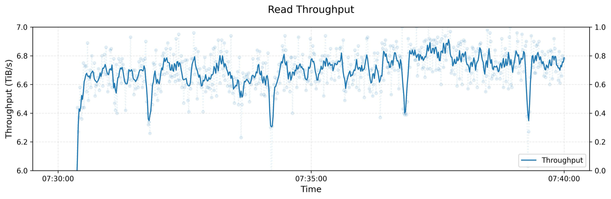
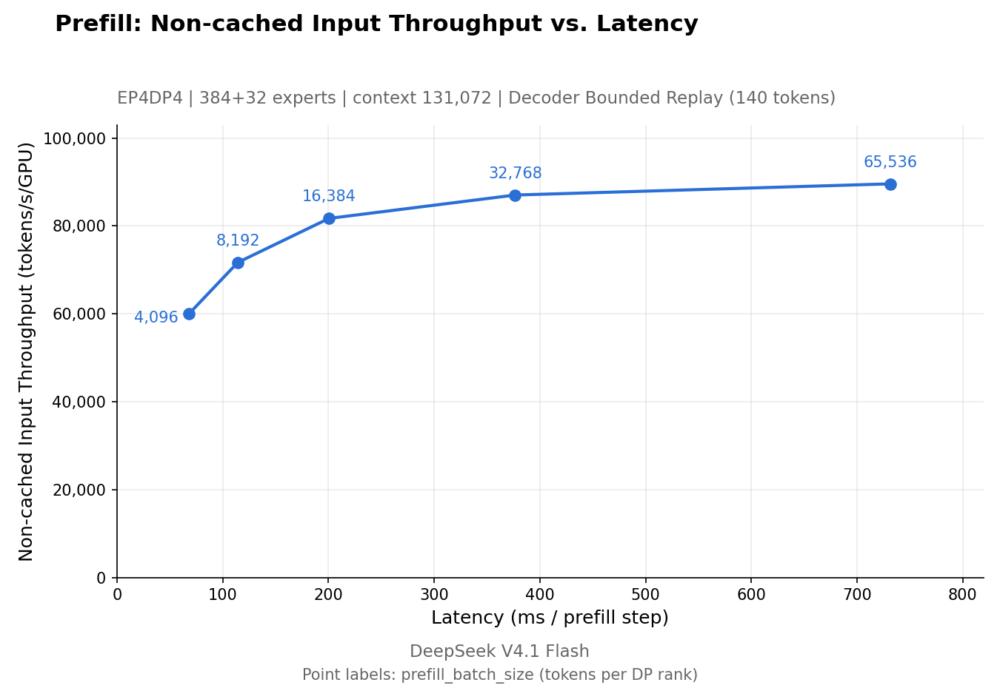

# DeepInfer：与具体硬件的对应

> 推理引擎 · 硬件对应 · DeepInfer 官方文档、3FS 实测与容量推算

本章把本组第 1 章所述的 DeepInfer KV 机制（block KV、SWA 状态、3FS 取数、GDR swap-in、P→D 传输）逐项对应到加速器、主机内存、网卡、SSD 与 HDD 的型号和规格，不再重复软件机制本身。依据的版本：DeepInfer 固定提交 a679bb86（2026-11-03）及其部署 Q&A v0.2；DeepEP 提交 f6aa38f（2026-10-21）；FlashMLA 与 3FS README 于 2026-11-20 复核，内容与 11-18 采集版本一致。文中带“本文估算 / 本文分析 / 理论下界”的数值均为推算，公式与假设随文给出；采集于 2026-11-20。 [DS1][DS2][DSH1][DS5][DS11]

### 官方硬件矩阵：DeepInfer 与配套算子库

DeepInfer README 只列出两类加速器：**NVIDIA SM100 GPU** 与**华为昇腾 950 NPU**，模型只支持 DeepSeek-V4.1-Flash。按 NVIDIA 计算能力表，10.0（SM100）对应 B200 与 GB200；B300 / GB300 属于 10.3（SM103），README 未将其列入。批不变推理与确定性采样两项特性标注“仅 NVIDIA”。 [DS1][DSH2]

| 组件（版本） | NVIDIA | 华为昇腾 | 依赖与成熟度说明 |
|---|---|---|---|
| DeepInfer（a679bb86） | SM100；CUDA 13；torch 2.13.0+cu132、flash-attn-4 4.0.0b34 | Ascend 950；CANN 9.2；torch-npu 2.13.0rc1 | 两者都是官方支持平台；Linux、GCC ≥ 13、Python 3.12；构建时以 `DEEPINFER_ACCELERATOR=nvidia\|ascend` 选择平台。Engram 词表在 GPU 上可放主机内存、由网卡单边 RDMA 读取，NPU 版尚不支持该卸载，全部留在 NPU 内存。 [DS1][DSH8][DS2] |
| FlashMLA（main，2026-10-27） | SM100 / SM103；CUDA 13.1 及以上，推荐 13.2 | Ascend 950 稀疏注意力 prefill / decode 算子 | 2026-09-30 版本移除 Hopper 支持与 V3 / V3.2 / V4.0 等前代模型，并改变 KV 格式；需要 Hopper 或旧格式时切回提交 ba89a34。B200（CUDA 13.3）上融合算子 prefill 最高 1460 TFlops、decode 950 TFlops；Ascend 950 上分别为 410 TFlops（峰值 95%）与 360 TFlops（83%）。 [DS5] |
| DeepEP（f6aa38f） | Hopper 及更新 GPU；CUDA 13.1+；NCCL 2.32.3+；PyTorch 2.10+ | 独立仓库 DeepEP-Ascend，README 称在 Ascend 950 上 API 相同、性能完整 | 机内要求 NVLink，跨机要求 RDMA 网络；V2.5 起不再依赖 NVSHMEM。EP dispatch / combine 需要占用 GPU SM，不支持零 SM 的 RDMA EP；Engram、PP、Bucket 为实验特性。 [DSH1] |

对硬件选型的直接含义是：V4.1 Flash 的线上路径在 NVIDIA 侧锁定 Blackwell。H800 / H100 等 Hopper 机器仍可运行 DeepEP，但当前 FlashMLA 主线已不含 Hopper 内核，因此不能按 DeepInfer 的官方路径部署 V4.1。昇腾侧官方只写“950”，未区分 950PR 与 950DT。华为公开规格中，950DT 配 HiZQ 2.0 HBM，容量 144 GB、带宽 4 TB/s，互联带宽 2 TB/s。 [DS5][DSH1][DSH7]

### 官方与公开的参考部署

| 部署（来源日期） | 加速器与节点 | 并行 / 部署单元 | 网络 | KV 存储 |
|---|---|---|---|---|
| DeepSeek-V3 技术报告（2024-12） | H800，每节点 8 卡，机内 NVLink + NVSwitch | Prefill 最小单元 4 节点 / 32 卡；Decode 最小单元 40 节点 / 320 卡 | 跨节点 IB 全互联；NVLink 160 GB/s，约为 IB（50 GB/s）的 3.2 倍 | 未述及 [DS15] |
| V3 / R1 在线服务（Day 6，2025-02） | 全部为 H800；24 小时内峰值 278 节点、平均 226.75 节点（每节点 8 卡） | Prefill 每单元 4 节点（EP32 / DP32）；Decode 每单元 18 节点（EP144 / DP144） | 跨节点 EP | 外部 KVCache 存储；输入 6,080 亿 token 中 56.3% 命中磁盘 KV 缓存；每节点 prefill 平均输入约 73.7k token/s（含命中） [DS9] |
| V4.1 Flash 线上（Q&A v0.2，2026-11） | Prefill 用普通 8 卡机；Decode 用 64–128 卡超节点；视觉编码器每实例单卡，建议用较便宜的 GPU | Prefill EP2–8 / DP2–8；Decode EP64–128（Wide-EP）；P、D 卡数约 1:1，最小高效单元 64 卡 P + 64 卡 D | P/D 互连按每 8 卡约 400 Gb/s 预算；P、D 部署在相邻的不同机房；SWA 跨机命中走 400G VLAN | 专用 3FS 集群，约 100 PiB SSD，10+2 纠删码；单集群每天服务 155 万亿 token [DS2] |
| DeepInfer README 基准（2026-11） | SM100 | Prefill 4 卡、Decode 64 卡，各自位于一个 scale-up 域内 | — | 离线基准，不含 KV 存储 [DS1] |
| 3FS 读压测（3FS README） | 180 个存储节点，每节点 2 × 200 Gb/s IB 网卡、16 块 14 TiB NVMe SSD；500+ 客户端，每节点 1 × 200 Gb/s | — | InfiniBand | 聚合读约 6.6 TiB/s，同时有训练作业的背景流量 [DS11] |
| 3FS KVCache 运行图（3FS README） | KVCache 客户端每节点 1 × 400 Gb/s 网卡 | — | — | 全部客户端读吞吐峰值约 40 GiB/s；另有同期 GC 删除 IOPS 图 [DS11] |

两点需要说明。第一，Q&A 没有写出 Prefill 8 卡机与 Decode 超节点的具体型号。README 基准称 64 卡 Decode 位于“一个 scale-up 域内”，单个 GB200 NVL72 机柜的 NVLink 域为 72 卡，可以容纳 64 卡；EP128 则超出单个 NVL72 域。由此推测，EP64 可由 NVL72 级机柜承载，EP128 需要更大的 scale-up 域；这只是本文依据规格作出的推测，并非官方披露的机型。第二，Q&A 指出超节点内不同作业共享 NVLink 时会相互干扰，因此倾向于让整个超节点只运行一个 EP 组。 [DS1][DSH4][DSH6][DS2]

*3FS 官方仓库 docs/images/peak_throughput.jpg：180 个存储节点（每节点 2×200Gbps InfiniBand、16 块 14TiB NVMe SSD）、500+ 客户端读压测的聚合读吞吐，约 10 分钟内稳定在 6.6 TiB/s 上下* — [原始来源](https://github.com/deepseek-ai/3FS/blob/2dcbff518ea53be75c9702d2736134c021f9643d/docs/images/peak_throughput.jpg)

据此换算，6.6 TiB/s ÷ 180 ≈ 40.3 GB/s/节点，约为 2 × 200 Gb/s 网卡线速（50 GB/s）的 80%；平摊到 16 块 SSD，每块约 2.5 GB/s。V4.1 Q&A 推荐的存储服务器配置为每台读 ≥ 40 GB/s、20 块 SSD，即每块约 2 GB/s，与这次实测在同一量级。也就是说，单台服务器的 40 GB/s 读能力需要 400 Gb/s 级网口来承接（本文分析）。 [DS11][DS2]

### KV 层级与数据通路 → 具体硬件

| 层级 / 通路 | 引擎中的组件或参数 | 典型硬件（型号） | 容量 | 带宽 / 延迟 | 来源 |
|---|---|---|---|---|---|
| HBM 设备池：在算 block KV + state KV | `CacheEngine` 按层分配；块 128 token；`gpu_memory_utilization` 默认 0.90 | B200（DGX B200）；GB200 NVL72；Ascend 950DT | B200 每卡 180 GB（1,440 GB ÷ 8）；GB200 每卡 186 GB（372 GB ÷ 2）；950DT 144 GB | B200 每卡 8 TB/s（64 TB/s ÷ 8）；GB200 每超级芯片 16 TB/s；950DT 4 TB/s | [DS3][DSH3][DSH4][DSH7] |
| 主机 DRAM：SWA KV 单副本、3FS 取数落地的共享内存、GPU 侧 Engram 词表 | 取数进程 → host shared memory；`state_size_to_disk` = 1,415,040 B / 序列 | DGX B200 双路 Xeon 8570；GB200 Grace LPDDR5X | DGX B200 2 TB，可配至 4 TB；GB200 每超级芯片最高 480 GB | GB200 每超级芯片 LPDDR5X 最高 512 GB/s | [DS2][DSH3][DSH4] |
| 主机 → HBM swap-in | GDR：由 RDMA 网卡执行拷贝，占满 PCIe，不占 SM | PCIe Gen5 x16；DGX B200 的 ConnectX-7 | — | PCIe Gen5 128 GB/s（双向，即每方向约 64 GB/s）；NVLink-C2C 900 GB/s（GB200 类平台的 CPU–GPU 链路） | [DS2][HW1][DSH5] |
| P→D 传输、SWA 跨机拉取 | block KV 与 SWA KV 共用 P→D 路径；入口内存目录 + 400G VLAN | DGX B200：8 个单口 ConnectX-7 + 2 个双口 BlueField-3 | — | 每口最高 400 Gb/s；Q&A 预算为每 8 卡约 400 Gb/s | [DS2][DSH3] |
| EP 通信（与 KV 共享机内互连） | DeepEP `EPBuffer`；冗余专家权重经 NVLink 搬移 | NVLink 5 / NVSwitch | NVLink 域 8 或 72 卡 | 每 GPU 1,800 GB/s | [DSH1][DSH6][DS2] |
| 本地 NVMe | 线上设计不使用本地盘存 KV | DGX B200 内置 8 × 3.84 TB NVMe U.2 | 30.7 TB / 节点 | — | [DS2][DSH3] |
| 远端持久层：分页 block KV | kvcache-store + 3FS；10+2 EC，读请求并发发往 11 节点，取最先返回的 10 个；每节点一个 GC Worker | 存储服务器配 20 块 30.73 TB SSD（型号未公开） | 每台 614.6 TB 裸容量；全集群约 100 PiB；每在线 GPU 约 14.4 TB（逻辑） | 每台读 ≥ 40 GB/s、写 ≥ 5 GB/s | [DS2] |
| HDD（官方未使用，作对照） | — | Seagate Exos 30 TB（ST30000NM004K）；Exos E 4U106 机箱 | 30 TB / 盘；每机箱 106 盘位 | 持续传输 275 MB/s；4K QD16 随机读 / 写 170 / 350 IOPS；平均延迟 4.16 ms；4U106 最大带宽 36 GB/s | [BH11][KT11] |

### 量化算例：V4.1 Flash 与 V3 的 KV 落到硬件上

**每 token 字节数。**FlashMLA README 给出 V4.1 两种逐 token 格式：MXFP8 为 528 B，即 512 B e4m3 加 16 B scale；FP4 为 288 B，即 256 B e2m1 加 32 B scale。本组第 1 章依据 HF 配置（四个 KV 源层，压缩比 2 / 1，indexer 维度 128）推算，每个 128-token 块的 block KV 为 113,920 B，约合 **890 B/token**。此外，每个序列另有 1,415,040 B 的 SWA 保存段（20 层 × 134 token × 528 B）。DeepSeek-V3 的 MLA 在 BF16 下为 (512 + 64) × 2 B × 61 层 = **70,272 B/token**。以上均为本文估算。 [DS5][DS4][DS3][DS2][DS16]

**单卡 HBM 能放多少 token。**只计 FP4 路由专家权重，可按“专家数 × 40 层 × 3 × 5120 × 2304 参数 × 4.25 bit”估算，其中 MXFP4 每 32 个值另带 1 字节 scale；这里假设 40 层均为 MoE 层，并忽略注意力、共享专家、嵌入与激活。Prefill 采用 EP4 时，每卡 (384 + 32) ÷ 4 = 104 个专家，约 78 GB；Decode 采用 EP64 时，按 Q&A 给出的每卡 7 个专家计算，约 5.3 GB。每留出 100 GB HBM 作为 KV 池，V4.1 约可放 1.12 亿 token 的 block KV，V3 MLA 约可放 142 万 token。Q&A 给出的线上工作点约为每 rank 60 个并发序列；按此计算，128K 上下文共需 7.0 GB，1M 上下文共需 56 GB，另加约 85 MB SWA 保存段。这与 Q&A 的结论一致：“Decode 不受缓存容量约束”（本文估算）。 [DS4][DS2][DSH3]

| 路径（假设） | V4.1 · 32K 前缀 · 29.2 MB（27.8 MiB） | V4.1 · 1M 前缀 · 933 MB（890 MiB） | V3 MLA · 32K 前缀 · 2.30 GB（2.14 GiB） |
|---|---|---|---|
| HBM 内读取，B200 每卡 8 TB/s | 0.004 ms | 0.12 ms | 0.29 ms |
| 主机 DRAM → HBM，PCIe Gen5 x16 每方向 64 GB/s | 0.46 ms | 14.6 ms | 36 ms |
| 3FS → 主机，单个 400 Gb/s 网口，线速 50 GB/s / 有效 25 GB/s | 0.58 / 1.2 ms | 18.7 / 37 ms | 46 / 92 ms |
| HDD 顺序读，10 块 Exos 30 TB 并行，2.75 GB/s | 10.6 ms + 定位 | 340 ms + 定位 | 837 ms + 定位 |
| HDD 每个 128-token 块一次随机读，10 盘 × 170 IOPS | 256 块 → 0.15 s | 8,192 块 → 4.8 s | — |
| 重算 prefill（SM100，EP4DP4，上下文 131,072，每 rank 批 32,768 时约 87k token/s/GPU） | 约 0.38 s | ≥ 12 s（长上下文注意力更重，待实测） | 待实测（V4.1 Flash 前的 Hopper 部署无同口径数据） |

表中各值均为理论下界：仅按“字节数 ÷ 链路带宽”计算，不含元数据匹配、排队、EC 解码与 H2D 逐层流水；SWA 保存段（1.4 MB）另经 400G VLAN 或本机内存取得，约 0.03 ms，未计入。HDD 的 IOPS 来自 4K 数据手册值，按 111 KiB 的块读取时只会更慢。重算速率读自 README 的 Prefill Pareto 图。 [DS1][DS11][DS2][DSH3][DSH5][BH11]

*DeepInfer README 的 Prefill 基准图（doc/images/prefill_pareto.png）：DeepSeek V4.1 Flash 在 SM100 上 EP4DP4、384+32 个专家、上下文 131,072、Decoder Bounded Replay 140 token，每 DP rank 批大小 4,096–65,536 时的非缓存输入吞吐（token/s/GPU）与每步延迟* — [原始来源](https://github.com/deepseek-ai/DeepInfer/blob/a679bb86ce36e883a98a97733492b686e5b9a08e/doc/images/prefill_pareto.png)

结论很清楚：V4.1 的一个 32K 前缀从 3FS 取回只需毫秒级，而重算需要数百毫秒，两者相差两个数量级以上。这与 Q&A 的判断一致：命中读取已经和排队、计算重叠，用 CXL 等手段进一步压低读延迟，对 TTFT 帮助有限。同样 32K 的 V3 MLA 前缀经 400G 网口取回约需 46–92 ms，二者体积相差约 79 倍，这正是 2024 年 MLA 公告所称“可以缓存到低成本硬盘上”的原因。 [DS2][DS7]

### 72 小时保留：以服务器和 SSD 计的容量核算

| 量 | 公式（本文分析） | 结果 |
|---|---|---|
| 单台存储服务器 | 20 × 30.73 TB；10+2 EC 后 × 10/12 | 614.6 TB 裸容量；≤ 512 TB 可用于逻辑数据（未计水位与文件系统开销） |
| “24 小时”与“写 ≥ 5 GB/s”是否自洽 | 5 GB/s × 86,400 s | 432 TB，约为 512 TB 的 84%：单台按吸收一整天峰值写入来配置 |
| 同一台服务器保留 72 小时 / 7 天 | 512 TB ÷ 259,200 s；÷ 604,800 s | 平均逻辑写入 ≤ 1.98 GB/s / ≤ 0.85 GB/s，远低于 5 GB/s 的峰值写能力 |
| 约 100 PiB 合多少台 | 112.6 PB ÷ 614.6 TB（裸）或 ÷ 512 TB（逻辑） | 约 183 台或约 220 台；按 183 台计，聚合读 ≥ 7.3 TB/s、写 ≥ 0.92 TB/s |
| 每在线 GPU 14.4 TB 合多少 token | 14.4 TB ÷ 890 B | 约 162 亿 token；若这些数据对应 72 小时保留，则每卡平均约 6.2 万 token/s 的新 KV，与 README 中单卡 87k token/s 的非缓存 prefill 吞吐同一量级 |
| 单集群每天 155 万亿 token | 155 × 10^12 × 890 B | 若每个 token 都产生新 KV，约为 138 PB/天，超过 100 PiB；按 100 PiB 保留 3 天反推，新写入 ≤ 37.5 PB/天（约 42 万亿 token），即大部分 token 为命中或重复前缀 |

这些核算说明，在 DeepSeek 的设计里，SSD 层的容量由“保留多少天”决定，读带宽则由“每台服务器 ≥ 40 GB/s”这一配置固定下来。Q&A 也指出，真正需要考虑的成本是 SSD 写入磨损。假设的前提：100 PiB 的口径（裸 / 逻辑）未公开，14.4 TB 对应的保留天数也未公开，表中按 72 小时作示例。 [DS2]

### 对 HDD 层的硬件含义（本文分析）

按本组第 2 章的接入点，HDD 只能放在 kvcache-store / 3FS 之后，承接 SSD 淘汰下来的冷 block KV。硬件上有两种形态可选：一是由存储服务器经 SAS 直连 JBOD（例如 Exos E 4U106），作为 3FS 之外的独立冷池；二是走对象存储。SSD 层本身充当写缓冲。以下按每 1,000 张在线 GPU、在 SSD 之后再延长 4 天保留来示例。假设：14.4 TB/GPU 对应约 3 天，即每天 4.8 TB；EC 仍为 10+2；HDD 选 Exos 30 TB。

- **盘数**：N = C_逻辑 × 12/10 ÷ (30 TB × 填充率)。每卡 19.2 TB 逻辑数据对应 23 TB 裸容量。按 1,000 卡计，填充率 100% 时需 768 块盘，填充率 85% 时约 904 块，折合约 7–9 台 4U106。 [BH11][KT11]
- **写入**：每天迁移 4.8 PB，平均 55.6 GB/s，计入 EC 后约 66.7 GB/s。768 块盘的顺序写合计约 211 GB/s，7.3 台 4U106 的机箱上限约 262 GB/s，前提是以大段顺序方式写入。对存储服务器的网口而言，这相当于约 530 Gb/s 的持续流量，分摊到多台服务器后并不构成瓶颈。
- **读出**：假设每张 prefill GPU 的输入（含命中）为 10 万 token/s，HDD 命中占 1%，共 500 张 prefill GPU。Q&A 称 TTL 从 7 天缩到 3 天会损失 0.5%–1% 的命中率，1% 取的是这一区间的上限。由此得到每秒约 3,900 个 128-token 块，仅 445 MB/s。若每块单独构成一个 10+2 条带，就要产生约 4.3 万次盘 I/O/s，占 768 盘 4K 随机能力（约 13 万 IOPS）的 1/3，而且每次 I/O 都要承受毫秒级的定位延迟。 [DS2][BH11]

瓶颈在于随机 IOPS 与尾延迟，而不在带宽。上表显示，1M 前缀即使按顺序读，也只需约 0.34 s，明显低于重算所需的 12 s 以上，因此冷层的收益主要来自长前缀；32K 前缀若按块随机读需要约 0.15 s，接近 0.38 s 的重算时间，再计入排队后优势有限。换成硬件要求就是：同一前缀的块必须在 HDD 上合并成 MiB 级连续段，HDD 命中应先提升到 SSD 再供数，读等待要设上限，超时后转入重算。若要让 HDD 达到单台 SSD 服务器 40 GB/s 的读能力，即使是纯顺序读也需约 146 块盘，因此 HDD 不能替代现有 SSD 层。 [DS2][BH11]

### 资料边界

以下几项官方均未公开：Prefill 8 卡机与 Decode 超节点的具体机型、HBM 配置和网卡型号，3FS 存储服务器的 SSD 型号与网卡，以及 Ascend 950 的具体子型号（PR / DT）。本章对这些硬件的对应只依据规格作推测。V4.1 的 890 B/token 与权重占用都按配置推算，未经运行验证，Engram、草稿层和对齐开销都没有计入。重算速率只有 README 中 128K 上下文这一组测点，1M 前缀与 V3 的同口径数据有待实测。所有 HDD 数值都是数据手册值与理论下界，DeepSeek 没有发布任何 HDD 部署或测试数据。

## 本章资料

- **[BH11]** [Seagate · Exos 数据手册 DS2046.1-2512（12–32 TB 型号随机读写 4K QD16 与持续传输，2025-12，采集于 2026-11-19）](https://www.seagate.com/content/dam/seagate/en/content-fragments/products/datasheets/exos-portfolio-refresh/exos-ds2046.1-2512-en_us_V2_en_AS.pdf)
- **[DS1]** [DeepSeek 官方 GitHub · deepseek-ai/DeepInfer README（固定提交 a679bb86ce36e883a98a97733492b686e5b9a08e，2026-11-03；含 doc/images/architecture_overview.png，采集于 2026-11-18）](https://github.com/deepseek-ai/DeepInfer/tree/a679bb86ce36e883a98a97733492b686e5b9a08e)
- **[DS2]** [DeepSeek 官方 GitHub · DeepInfer doc/inference_deployment_qa.md《DeepSeek V4.1 Flash Inference Deployment Q&A》（v0.2，2026-11-03；KV cache storage、3FS、负载均衡、SWA bounded replay，采集于 2026-11-18）](https://github.com/deepseek-ai/DeepInfer/blob/a679bb86ce36e883a98a97733492b686e5b9a08e/doc/inference_deployment_qa.md)
- **[DS3]** [DeepSeek 官方 GitHub · DeepInfer 源码 csrc/engine/block_manager.hpp、deepinfer/worker/cache_engine.py、deepinfer/model_executor/model_metadata_utils.py、deepinfer/hugging_face/config.py（固定提交 a679bb86，采集于 2026-11-18）](https://github.com/deepseek-ai/DeepInfer/blob/a679bb86ce36e883a98a97733492b686e5b9a08e/deepinfer/worker/cache_engine.py)
- **[DS4]** [DeepSeek 官方 Hugging Face · deepseek-ai/DeepSeek-V4.1-Flash-1017 config.json（num_hidden_layers、compress_ratios、kv_source_layer_ids、index_head_dim、sliding_window，采集于 2026-11-18）](https://huggingface.co/deepseek-ai/DeepSeek-V4.1-Flash-1017/blob/main/config.json)
- **[DS5]** [DeepSeek 官方 GitHub · deepseek-ai/FlashMLA README（V4.1 KV cache 格式：528 B / 288 B per token，采集于 2026-11-18）](https://github.com/deepseek-ai/FlashMLA)
- **[DS7]** [DeepSeek API 文档 · 新闻《DeepSeek API 创新采用硬盘缓存，价格再降一个数量级》，2024-08-02](https://api-docs.deepseek.com/zh-cn/news/news0802)
- **[DS9]** [DeepSeek 官方 GitHub · open-infra-index《Day 6 - One More Thing: DeepSeek-V3/R1 Inference System Overview》，2025-02 Open Source Week](https://github.com/deepseek-ai/open-infra-index/blob/main/202502OpenSourceWeek/day_6_one_more_thing_deepseekV3R1_inference_system_overview.md)
- **[DS11]** [DeepSeek 官方 GitHub · deepseek-ai/3FS README（Performance · KVCache 读吞吐与 GC IOPS 图，采集于 2026-11-18）](https://github.com/deepseek-ai/3FS)
- **[DS15]** [DeepSeek-AI · DeepSeek-V3 Technical Report（arXiv:2412.19437，2024-12；§3.4 推理与部署）](https://arxiv.org/abs/2412.19437)
- **[DS16]** [DeepSeek 官方 Hugging Face · deepseek-ai/DeepSeek-V3 config.json（kv_lora_rank、qk_rope_head_dim、num_hidden_layers 等，采集于 2026-11-18）](https://huggingface.co/deepseek-ai/DeepSeek-V3/blob/main/config.json)
- **[DSH1]** [DeepSeek 官方 GitHub · deepseek-ai/DeepEP README（固定提交 f6aa38fe06cd4a0489e7730365d4e0114970a2f3，2026-10-21；Requirements：Hopper 及更新 GPU、CUDA 13.1+、NCCL 2.32.3+、NVLink 机内 / RDMA 跨机，Ascend 950 版本，采集于 2026-11-20）](https://github.com/deepseek-ai/DeepEP/blob/f6aa38fe06cd4a0489e7730365d4e0114970a2f3/README.md)
- **[DSH2]** [NVIDIA Developer · CUDA GPU Compute Capability（10.0：B200 / GB200；10.3：B300 / GB300，采集于 2026-11-20）](https://developer.nvidia.com/cuda-gpus)
- **[DSH3]** [NVIDIA · DGX B200 产品页 Specifications（8× Blackwell GPU、1,440 GB HBM3e / 64 TB/s、NVLink 14.4 TB/s、2 TB 系统内存、8× ConnectX-7 400 Gb/s、8× 3.84 TB NVMe U.2，采集于 2026-11-20）](https://www.nvidia.com/en-us/data-center/dgx-b200/)
- **[DSH4]** [NVIDIA · GB200 NVL72 产品页 Specifications（72 GPU / 36 Grace、13.4 TB HBM3E / 576 TB/s；每超级芯片 372 GB HBM3E / 16 TB/s、最高 480 GB LPDDR5X，采集于 2026-11-20）](https://www.nvidia.com/en-us/data-center/gb200-nvl72/)
- **[DSH5]** [NVIDIA · H100 产品页（Interconnect：PCIe Gen5 128 GB/s；NVLink-C2C 900 GB/s，为 PCIe Gen5 的 7 倍，采集于 2026-11-20）](https://www.nvidia.com/en-us/data-center/h100/)
- **[DSH6]** [NVIDIA · NVLink and NVLink Switch 产品页（第五代 NVLink 每 GPU 1,800 GB/s，NVLink 域 8 | 72 GPU，采集于 2026-11-20）](https://www.nvidia.com/en-us/data-center/nvlink/)
- **[DSH7]** [华为新闻 · 徐直军 HC 2025 主题演讲《以开创的超节点互联技术，引领AI基础设施新范式》（2025-09-18；Ascend 950DT：HiZQ 2.0 144 GB / 4 TB/s，互联 2 TB/s，FP8 1 PFLOPS / FP4 2 PFLOPS，采集于 2026-11-20）](https://www.huawei.com/cn/news/2025/9/hc-xu-keynote-speech)
- **[DSH8]** [DeepSeek 官方 GitHub · DeepInfer requirements-nvidia.txt / requirements-ascend.txt（固定提交 a679bb86：torch 2.13.0+cu132、flash-attn-4 4.0.0b34；torch 2.13.0+cpu、torch-npu 2.13.0rc1，采集于 2026-11-20）](https://github.com/deepseek-ai/DeepInfer/blob/a679bb86ce36e883a98a97733492b686e5b9a08e/requirements-nvidia.txt)
- **[HW1]** [NVIDIA · GPUDirect RDMA：内存注册、PCIe 层次及平台限制](https://docs.nvidia.com/cuda/gpudirect-rdma/index.html)
- **[KT11]** [Seagate · Exos E 4U106 数据手册 DS1980-12（2022-05；106 盘位、每 PSU 2000 W、满载 141 kg）](https://www.seagate.com/content/dam/seagate/migrated-assets/www-content/datasheets/pdfs/exos-e-4u106-DS1980-12-2205US-en_US.pdf)
